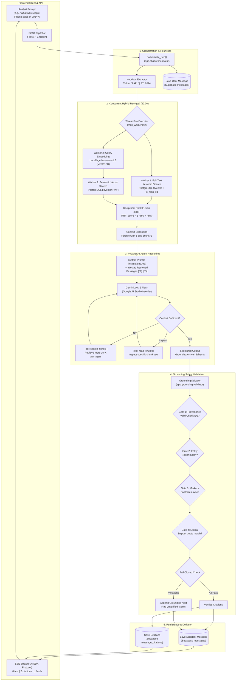

# Document Assistant — Pipeline Architecture

The `app.assistant` package contains the core AI reasoning and synthesis engine for **Meridian Research's Document Assistant**.

It orchestrates between **hybrid document retrieval**, **PydanticAI agent reasoning with Gemini Flash**, **grounding safety verification**, and **database persistence with real-time SSE streaming**.

---

## End-to-End Pipeline Flowchart

---

## Detailed Pipeline Breakdown

### 1. Ingestion & Pre-Retrieval Context Gathering
When an analyst submits a query:
1. **User Message Persistence**: The prompt is persisted in the Supabase `messages` table with role `user`.
2. **Metadata Heuristics**: Lightweight regex in `_extract_ticker_and_fy()` checks for known company tickers (`AAPL`, `NVDA`, `MSFT`, `AMZN`, `GOOGL`) and fiscal years (`2020`–`2025`) to narrow candidate search filters.

### 2. Concurrent Hybrid Retrieval Engine (`app.retrieval`)
To minimize turnaround time while running zero paid APIs:
1. **Parallel Workers (`ThreadPoolExecutor`)**:
   - **Worker 1 (FTS)**: Immediately executes PostgreSQL full-text search with `extract_salient_keywords()`, `websearch_to_tsquery`, and fallback `ts_rank_cd` ranking.
   - **Worker 2 (Semantic)**: Simultaneously generates a 768-dimensional query embedding via local `bge-base-en-v1.5` on Apple Silicon MPS/CPU, followed by `pgvector` cosine similarity search.
2. **Reciprocal Rank Fusion (RRF)**: Merges the candidates without requiring fragile score normalization:
   $$RRF(d) = \sum_{m \in \{\text{semantic}, \text{keyword}\}} \frac{1}{60 + \text{rank}_m(d)}$$
3. **Neighbor Boundary Expansion**: For the top 5 passages, fetches neighboring chunks ($chunk - 1$ and $chunk + 1$) from PostgreSQL so multi-page tables and surrounding context are not cut off.

### 3. Agent Reasoning with PydanticAI (`app.assistant`)
1. **System Prompt & Instructions**:
   - Loads Meridian Research compliance directives from [`instructions.md`](instructions.md): strict corpus grounding, refusal to infer causation without explicit filing attribution, and refusal of stock tips or price targets.
2. **Dynamic Context Injection**:
   - Passes the 5 pre-retrieved passages directly into the prompt using numbered footnote labels (`[^1]`, `[^2]`, etc.) and database `Chunk ID`s.
3. **Autonomous Tool Loop**:
   - If initial context is insufficient or requires comparative cross-company analysis, the agent can invoke:
     - `search_filings(query, ticker, fiscal_year, top_n)`
     - `read_chunk(chunk_id)`
4. **Structured Answer Schema**:
   - Enforces typed extraction using `GroundedAnswer` with a markdown body and a structured list of `CitationItem` objects.

### 4. Grounding Safety Validation Engine (`app.grounding`)
Every generated response passes through a fail-closed 4-gate validation pipeline before reaching the analyst:
- **Gate 1 (Provenance)**: Confirms that all cited `chunk_id` UUIDs were actually retrieved in the current session.
- **Gate 2 (Entity Consistency)**: Verifies that claimed tickers match the actual passage ticker.
- **Gate 3 (Footnote Synchronization)**: Verifies that every in-text marker (e.g., `[^1]`) has a corresponding citation object and vice-versa.
- **Gate 4 (Lexical Snippet Verification)**: Checks that quoted supporting phrases exist inside the source passage text.

*If any gate detects a violation in strict mode, the answer is flagged with a visible alert.*

### 5. Persistence & Streaming Delivery (`app.chat`)
1. **Database Writes**:
   - Assistant response is stored in `messages`.
   - Verified citations are stored in `message_citations` linked to their respective `chunk_id`s.
2. **Vercel AI SDK SSE Stream**:
   - Streams chunks to the frontend:
     - `0:"text"` — incremental words and markdown formatting.
     - `2:[{...}]` — structured citation metadata for interactive citation sidebars and badges.
     - `d:{"finishReason": "stop"}` — stream completion event.

---

## File Structure

| File | Purpose |
| :--- | :--- |
| **[`agent.py`](agent.py)** | PydanticAI agent definition, dynamic prompt injection, and tool functions (`search_filings`, `read_chunk`). |
| **[`instructions.md`](instructions.md)** | Core compliance prompt enforcing strict grounding, refusal directives, and citation guidelines. |
| **[`instructions.py`](instructions.py)** | Cached system instructions loader with LRU caching. |
| **[`model.py`](model.py)** | Google AI Studio Gemini model factory (`gemini-3-flash-preview`). |
| **[`schemas.py`](schemas.py)** | Pydantic output schemas (`GroundedAnswer`, `CitationItem`). |

---

## Cost & Privacy Architecture

- **Embedding & Chunking**: 100% local (`BAAI/bge-base-en-v1.5` on MPS/CPU) — **$0.00**.
- **Vector & Keyword Storage**: Self-hosted Supabase PostgreSQL (`pgvector` + `tsvector`) — **$0.00**.
- **Agent Reasoning**: Google AI Studio free tier Gemini Flash preview — **$0.00**.
- **Net Operational Cost**: **$0.00 / month** for development and local testing.
