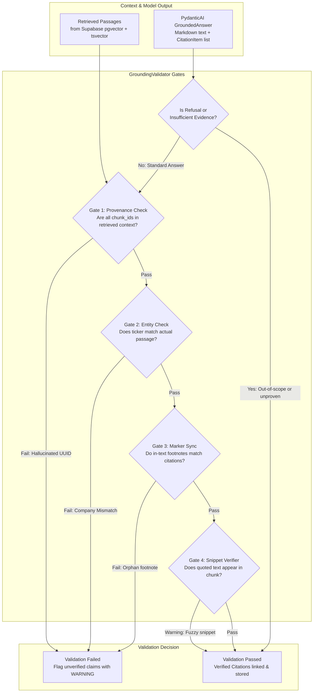

# Grounding Safety Engine — Document Assistant

The `app.grounding` package implements Meridian Research's core trust contract: **every claim, financial metric, and comparison must be strictly grounded in retrieved SEC 10-K passages**.

A wrong but confident answer destroys an investment research franchise. The Grounding Engine provides automated, fail-closed validation to prevent LLM hallucinations from ever reaching institutional analysts.

---

## Architecture & Validation Flow



---

## The 4 Verification Gates

### Gate 1: Chunk Provenance Check (Anti-Hallucination)
- **Problem**: Large language models may fabricate source passage identifiers or hallucinate database IDs.
- **Enforcement**: The validator maps every `citation.chunk_id` against the set of `chunk_id`s genuinely retrieved and provided in the current session context.
- **Outcome**: If an answer cites a `chunk_id` that wasn't retrieved, validation **fails closed** (`is_valid = False`).

### Gate 2: Entity & Ticker Consistency
- **Problem**: In multi-company comparisons (e.g. comparing AAPL and MSFT), models can accidentally attribute a Microsoft passage to Apple.
- **Enforcement**: The validator verifies that `citation.ticker` strictly matches `passage.ticker`.
- **Outcome**: Prevents cross-company attribution errors.

### Gate 3: In-Text Citation Marker Synchronization
- **Problem**: Text containing dangling footnotes like `[^4]` with no corresponding citation object, or citation objects not referenced in the text.
- **Enforcement**: Uses regex `r"\[\^(\d+)\]"` to cross-check every bracketed marker against the list of `verified_citations`.

### Gate 4: Lexical Snippet Verification
- **Problem**: Misquoting numbers or metrics (e.g. turning $201 million into $201 billion).
- **Enforcement**: Normalizes and checks that the quoted snippet appears verbatim (or with high lexical overlap) inside the underlying chunk text.

---

## Edge Case Handling

| Scenario | Behavior | Example |
| :--- | :--- | :--- |
| **Direct Metric Extraction** | Full validation across all 4 gates | Citing Apple iPhone net sales of $201,183M with `[^1]` |
| **Unproven Causation (Client Brief Q10)** | Refuses to extrapolate beyond filing text | Does GenAI improve Amazon margins? Discloses that management notes impacts are *"difficult to isolate and quantify"* |
| **Insufficient Evidence** | Bypasses citation requirement, passes cleanly | *"Based on the available 10-K filings, this is not disclosed."* |
| **Out-of-Scope Request** | Formats explicit refusal, bypasses citations | *"As Meridian Research's Document Assistant, I cannot provide trading recommendations or stock picks."* |

---

## Data Structures

```python
class CitationItem(BaseModel):
    chunk_id: uuid.UUID
    citation_label: str  # e.g. "[^1]"
    ticker: str
    company_name: str
    fiscal_year: int
    filing_type: str = "10-K"
    section: str
    snippet: str  # verbatim quote supporting the claim

class GroundedAnswer(BaseModel):
    answer: str
    citations: list[CitationItem]
    has_sufficient_evidence: bool = True
    refusal_reason: str | None = None
```

---

## Usage Example

```python
from app.grounding.validator import GroundingValidator

validator = GroundingValidator(strict=True)

# Validate answer against retrieved context
result = validator.validate(
    answer=grounded_answer,
    retrieved_passages=retrieved_passages,
)

if result.is_valid:
    print(f"Verified {len(result.verified_citations)} citations successfully.")
else:
    print(f"Grounding violations detected: {result.errors}")
```
