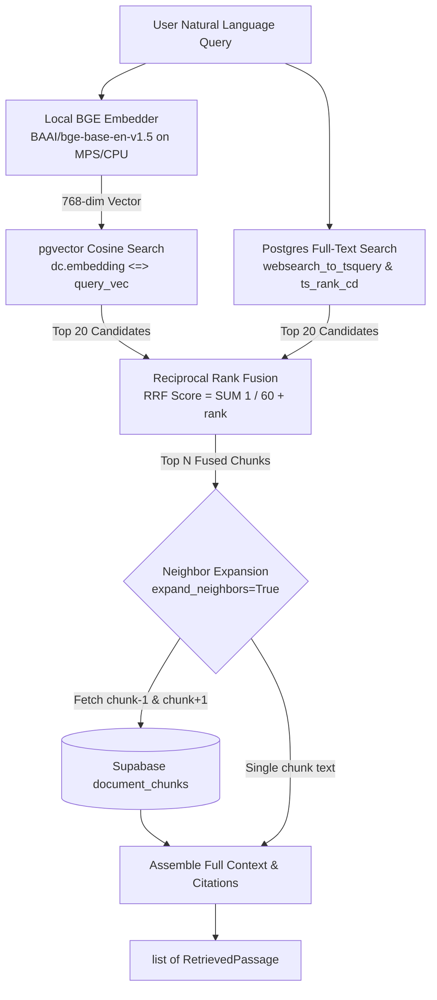

# Retrieval Engine — Document Assistant

The `app.retrieval` package provides hybrid retrieval over SEC 10-K document chunks stored in Supabase PostgreSQL. It combines local dense vector embeddings with Postgres full-text keyword search, fuses candidate lists using **Reciprocal Rank Fusion (RRF)**, and expands neighboring chunks for financial context boundaries.

---

## Architecture & Pipeline Flow



---

## Step-by-Step Retrieval Pipeline

1. **Local Query Embedding**:
   - The query string is encoded locally via `ingest.embedder.LocalEmbedder` using `BAAI/bge-base-en-v1.5`.
   - Generates a normalized **768-dimensional float vector** running locally on Apple Silicon Metal (`mps`) or CPU ($0.00 external API cost).

2. **Parallel Hybrid DB Searches**:
   - **Semantic Search (`queries.search_semantic`)**: Executes `dc.embedding <=> CAST(:query_vec AS vector)` with HNSW index scan.
   - **Keyword Full-Text Search (`queries.search_keyword`)**: Executes `dc.search_vector @@ websearch_to_tsquery('english', :query_text)` ranked with Cover Density Ranking (`ts_rank_cd`).
   - Dynamic filters (`sd.ticker = :ticker`, `sd.fiscal_year = :fiscal_year`) are applied when specified.

3. **Reciprocal Rank Fusion (`fusion.reciprocal_rank_fusion`)**:
   - Scores each candidate across both ranked candidate lists using:
     $$\text{RRF}(d) = \sum_{m \in \{\text{semantic}, \text{keyword}\}} \frac{1}{k + \text{rank}_m(d)}$$
   - Documents appearing in **both** search branches receive boosted scores (`~0.031+`) and are tagged as `search_type="hybrid"`.

4. **Context Window Neighbor Expansion**:
   - Boundary-truncated tables or financial commentary often span adjacent chunks.
   - For each top fused chunk, `fetch_neighbor_chunks` retrieves `chunk_index - 1` and `chunk_index + 1` from the same `document_id`.
   - `full_context_text` is formatted with clean boundaries for downstream LLM grounding.

5. **Citation Generation**:
   - Constructs human-readable source citations matching Meridian Research standards:
     `"{company_name} ({ticker}) FY{fiscal_year} 10-K [{section_headings}]"`

---

## Default Configuration & Settings

| Parameter | Default | Location | Description |
| :--- | :--- | :--- | :--- |
| `embedding_model` | `BAAI/bge-base-en-v1.5` | `app.config.settings` | Local HuggingFace sentence-transformers model |
| `embedding_dimensions` | `768` | `app.config.settings` | Dimensionality matching pgvector column `vector(768)` |
| `top_n` | `5` | `Retriever.retrieve()` | Final number of ranked passages returned |
| `candidate_limit` | `20` | `Retriever.retrieve()` | Number of candidates pulled from each search branch before RRF |
| `k` (RRF constant) | `60` | `fusion.DEFAULT_RRF_K` | Standard smoothing parameter from Information Retrieval literature |
| `expand_neighbors` | `True` | `Retriever.retrieve()` | Automatically fetches `chunk-1` and `chunk+1` context |
| `device` | `mps` (Apple) / `cpu` | `LocalEmbedder` | Auto-detects Apple Silicon Metal Performance Shaders |

---

## Module Overview

- **[`models.py`](models.py)**: Pydantic schemas:
  - `RetrievedChunk`: Single search branch candidate with scores and metadata.
  - `FusedChunk`: RRF-merged candidate with reciprocal rank scores.
  - `RetrievedPassage`: Final passage with neighbor text and citation.
- **[`queries.py`](queries.py)**: Raw SQLAlchemy database execution for vector and full-text queries.
- **[`fusion.py`](fusion.py)**: Pure-Python RRF implementation with deterministic tie-breaking.
- **[`retriever.py`](retriever.py)**: Orchestrator service combining embedder, queries, fusion, and context assembly.

---

## Usage Example

```python
from app.retrieval import Retriever

# Initialize retriever (singleton engine + local BGE model)
retriever = Retriever()

# Run query with optional ticker and fiscal year filters
passages = retriever.retrieve(
    query="Apple revenue mix iPhone Services Mac 2024",
    ticker="AAPL",
    fiscal_year=2024,
    top_n=3,
    expand_neighbors=True,
)

for p in passages:
    print(f"[{p.citation_source}] Score: {p.rrf_score:.4f} (Table: {p.is_table})")
    print(p.full_context_text[:300])
```
